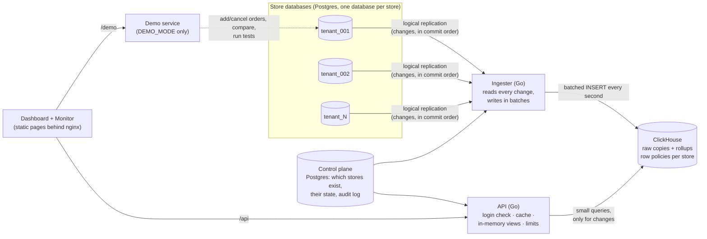
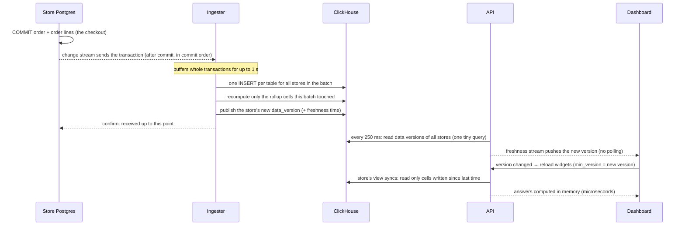

# TenantPulse: the complete guide

This guide explains what TenantPulse does, how every piece works, why it is
built this way, what happens in every situation we could think of, and how
we measured it. It is written to be read top to bottom by someone who has
never seen the code. Technical terms are explained the first time they appear
and collected in the [glossary](#14-glossary) at the end.

**Contents**

1. [In one minute](#1-in-one-minute)
2. [The problem](#2-the-problem)
3. [The big picture](#3-the-big-picture)
4. [Life of an order: from checkout to dashboard](#4-life-of-an-order-from-checkout-to-dashboard)
5. [Life of a dashboard read](#5-life-of-a-dashboard-read)
6. [Why this approach](#6-why-this-approach)
7. [Getting the numbers exactly right](#7-getting-the-numbers-exactly-right)
8. [Keeping stores apart (isolation and security)](#8-keeping-stores-apart-isolation-and-security)
9. [Every case: what happens when…](#9-every-case-what-happens-when)
10. [Performance and scaling](#10-performance-and-scaling)
11. [How we test it, and how to show the results](#11-how-we-test-it-and-how-to-show-the-results)
12. [Results](#12-results)
13. [Running and operating it](#13-running-and-operating-it)
14. [Glossary](#14-glossary)

---

## 1. In one minute

**What it is.** TenantPulse is the analytics layer for a commerce platform
that hosts many stores ("tenants"). Each store has its own Postgres database
where checkouts happen. Store owners want a live dashboard: orders, sales,
order status and top products, for today, 7, 30 or 90 days.

**The problem.** If the dashboard asks the store's own database, the
dashboard is slow (it scans thousands to millions of orders on every view)
*and* the store gets slow (those scans compete with checkouts).

**The answer.** TenantPulse copies every change out of the store databases
as it happens (Postgres logical replication, no polling), lands it in
ClickHouse (a database built for analytics), keeps small pre-added totals
("rollups") up to date, and serves the dashboard from those totals through an
API with an in-memory cache. Dashboards never touch a store database.

**What that buys.** Dashboard reads answer in well under a millisecond from
memory, new orders show up about two seconds after checkout, the numbers match
a direct SQL query on the store database exactly, and dashboards never send a
query to a store database.
The measured numbers at 1M and 10M rows are in [section 12](#12-results).

---

## 2. The problem

Picture a platform with 100 stores. Every store's database takes orders all
day. Every store owner keeps a dashboard open that refreshes when new data
arrives.

A dashboard question such as "orders and sales per day for the last 90 days,
split by currency" needs to read every order from those 90 days. On a large
store that is hundreds of thousands of rows, read again on every refresh by
every viewer. Two things go wrong at once:

1. **The dashboard is slow**, because each view repeats a large scan.
2. **The store is slow**, because those scans use the same CPU, memory and disk
   as checkouts. A store that slows down at checkout loses sales.

Indexes help a little, but every extra index makes every checkout write more
data, and the scans still grow with the store. We measured this: see the
"ladder" in [section 12](#12-results).

### What "good" means (the targets)

| Goal | Good | Great |
|---|---|---|
| Dashboard query time at 10M rows | < 1 s | < 200 ms |
| Freshness: checkout → visible on the dashboard | < 5 min | < 30 s |
| Store safety: extra slowdown of store transactions | < 25% | < 10% |
| Correctness | exact match with the store database | |
| Growth: query time from 1M to 10M rows | < 5× slower | < 2× slower |

Non-negotiables: one store must never see another store's data; no customer
personal data leaves the store databases; dashboard requests must never query
a store database; credentials never go into git, databases or logs.

---

## 3. The big picture



| Piece | Job | Notes |
|---|---|---|
| **Store databases** | Where checkouts happen. One Postgres database per store. | Untouched by dashboards. Only the change stream reads them. |
| **Control plane** | A small Postgres that lists stores, their timezone, currency, state and "generation" (see [rebuilds](#9-every-case-what-happens-when)), plus an audit log. | The source of truth for "who is who". |
| **Ingester** | Reads each store's change stream, turns changes into rows, writes them to ClickHouse once a second for all stores together, updates the rollups, then tells Postgres "received". | One process can follow hundreds of stores; more ingesters split the stores between them. |
| **ClickHouse** | Holds a copy of orders, order lines and products for every store, plus the rollups (pre-added totals per day, per hour, per product per day). | Columnar analytics database. Built for fast sums over many rows. |
| **API** | Checks who is asking, answers dashboard questions from memory where it can, otherwise asks ClickHouse, and limits load. | Stateless. Run as many copies as needed. |
| **Dashboard and Monitor** | Static web pages (Astro, served by nginx). Every number is fetched from the API with the viewer's token. | Monitor shows live latency, cache rate, ingest rate and lag, one row of live charts per read path, and benchmark results. |
| **Demo service** | Only when `DEMO_MODE=true`: add or cancel a real order, compare with direct SQL, run the stress tests from a button. | The only runtime service besides the ingester that can reach store databases. Off in production. |
| **`tpctl`** | Command-line tool: create stores, load test data, verify, rebuild, run benchmarks. | |

---

## 4. Life of an order: from checkout to dashboard

What happens, step by step, when a customer checks out. Typical times are
from our measurements.



1. **Checkout commits** in the store database: one transaction inserts the order
   and its lines. Nothing else happens inside the store's transaction: no
   trigger, no extra write, no call to another system.
2. **Postgres streams the change.** Logical replication reads the store's
   write-ahead log (WAL, the journal Postgres already writes for crash safety)
   and sends each committed transaction to the ingester, in commit order. The
   store's checkout does not wait for this.
3. **The ingester batches.** It keeps whole transactions and, once a second (or
   every 50,000 rows), writes one `INSERT` per table covering every store that
   changed. ClickHouse is fastest with few, large inserts.
   Each row carries `_version` = its position in the WAL, so a newer version of
   a row always wins.
4. **Rollups are refreshed, bottom-up.** The rollups form a small hierarchy:

   ```
   raw orders + lines ──▶ 15-minute cells ──▶ hour cells
                                      ├──▶ store-local day cells
                                      └──▶ product-day cells ──▶ product-month cells
   ```

   For each store in the batch, the ingester notes which 15-minute buckets
   changed (the creation time of each affected order; for a line, its order's).
   It re-reads raw rows **only for those quarter-hours**, at most 15 minutes of
   one store's orders, and rebuilds them. Hours, days, product days and
   product months are then summed from the 15-minute cells, and product cells
   only for the products that actually changed. Every timezone offset in use
   is a multiple of 15 minutes, so a store's local day is exactly a set of
   these buckets, even in India (+5:30) or Nepal (+5:45). The work per batch
   therefore follows how much was written, not how much data exists or how far
   into the day it is. Every level is recomputed (never "+1"), so a replay
   gives the same answer.
5. **The store's `data_version` is bumped** (at most once a second per store),
   together with "data is complete up to time T". A new version always means the
   raw rows *and* the rollups are in place.
6. **Only now** does the ingester tell Postgres "received up to here". If anything
   crashed before this, Postgres re-sends, and step 4 makes the re-send harmless.
7. **The API notices** the new version on its next 250 ms poll.
8. **The dashboard is told.** Each open dashboard holds one streamed response
   (`/stream`, Server-Sent Events). The API pushes an event on it right after
   the poll that saw the new version, and otherwise only when the pipeline's
   health changes (live, lagging, stalled). With no changes nothing is sent
   but an invisible keepalive comment every 20 s. The dashboard reloads its
   four widgets and asks for "at least this version" so it can never show
   data older than its freshness badge. The badge reads "Live · last change
   4m ago": the time since the store's last real change, counted in the
   browser. If the stream cannot be opened (a proxy that blocks streaming,
   for example), the page polls `/freshness` every second instead.
9. **The API answers from memory.** Its in-memory view of the store reads only
   the rollup cells written since its last sync (a few rows) and computes the
   answer in microseconds.

**End to end:** about 1 second, mostly the batching interval. Measured numbers
are in [section 12](#12-results).

---

## 5. Life of a dashboard read

What happens when the dashboard asks, for example, "orders summary for the
last 30 days".

1. **nginx** serves the page and forwards `/api/...` to the API on the same
   origin (no cross-site requests).
2. **Who is asking?** The API checks the bearer token. A store token can read
   only that store; an operator token can read all. The store in the URL is
   only a *selector*: access comes from the token. Someone else's store gets
   HTTP 403, the same answer as for a store that does not exist, so store
   existence is not leaked.
3. **Is the store ready?** A store still loading its first copy answers
   `409 tenant_not_ready`, so the dashboard shows "loading" instead of partial
   numbers.
4. **The range is resolved in the store's timezone.** "Last 30 days" means 30
   whole local days including today: midnight 29 days ago (store time) until
   tomorrow's midnight. Daylight-saving changes are handled.
5. **Response cache.** The answer may already be in memory:

   | Status | Meaning | Typical time |
   |---|---|---|
   | `HIT` | Cached answer for the store's current data version. | ~0.03 ms |
   | `STALE` | New data has just arrived; the previous answer (at most 5 s old) is returned at once while the new one is computed in the background. Never used for a dashboard reload that asked for the new version. | ~0.03 ms |
   | `MISS` | Not cached: computed now (usually in memory, see 6). | 0.1–20 ms |
   | `BYPASS` | Benchmark-only: an operator asked to skip the cache and the views to time ClickHouse itself. | 10–300 ms |

   Identical requests that miss at the same moment share one computation
   ("singleflight").
6. **In-memory view.** For every store, the API keeps a copy of that store's
   daily totals, the last 72 hours of hourly totals, the last 95 days of
   product-day totals and the product names. When the store's data version
   changes, **one** query reads only the cells written since the last sync,
   usually a handful of rows. Summary, status breakdown and trends over whole
   days (all presets and date-picker ranges), hourly trends for today, and top
   products for today / 7 / 30 / 90 days are all computed from memory.
7. **ClickHouse fallback.** Anything the view cannot answer exactly (a custom
   range with exact times, 365-day top products, half-hour timezones at hour
   grain) is one ClickHouse query that reads whole calendar months from the
   product-month cells, whole days and hours from their rollups, and raw rows
   only for partial hours at the edges. Each table is read once, with all of
   its time ranges combined (a `FINAL` read costs about 10 ms however few rows
   it reads, so one read per range made an exact-time summary 14 reads).
8. **Limits.** At most N ClickHouse queries run per store and in total. A
   reader waits up to 1 s for a slot, then gets `429 Retry-After`. Background
   refreshes may use only half the slots, so readers always have the other half.
9. **The response** says how it was answered: `meta.cache` (`HIT`, `STALE`,
   `MISS`, `BYPASS`), `meta.source` (what computed it: `view` for the
   in-memory copy, `clickhouse` for a query), `took_ms` and `data_version`.
   Each widget shows that on screen ("served from cache", "computed in
   memory", "computed in ClickHouse").

Why both a cache and views? The cache makes repeat reads free. The views make
the *first* read after new data nearly free and turn "every widget × every
range × every store needs a ClickHouse query whenever data changes" into "one
tiny delta read per store per change".

---

## 6. Why this approach

### The main decision: copy changes out, add them up ahead of time, serve from memory

| Option | What it means | Why not (or why) |
|---|---|---|
| Query the store database directly | Dashboard runs SQL on the store's Postgres | Slow dashboards and slower checkouts. Measured: about 100–600 ms p95 for dashboards and a large store slowdown under load. This is the baseline we beat. |
| Tune the store database (indexes, partitions, read replicas) | Make those queries cheaper | Helps single queries (see ladder) but every index slows every checkout, scans still grow with the store, and replicas double storage and still scan. Partitioning by date helps pruning, not summing. |
| Postgres "webhooks" (triggers + NOTIFY or HTTP calls) | Each write fires a trigger that notifies another system | Runs **inside** the checkout transaction (slower checkouts), NOTIFY is not durable (messages are lost if nobody is listening), and HTTP from a trigger blocks the transaction. The WAL is the durable, ordered, after-commit version of the same idea, so we read the WAL. |
| Debezium + Kafka | Change data capture into a message queue, consumed by a sink | Works, but adds a Kafka cluster and a Connect cluster to run, and an extra hop. The judges also noted Kafka adds latency and operational weight. Our ingester reads the same WAL directly. A Kafka sink can be added behind the same interface if other teams need the stream. |
| **Logical replication → ingester → ClickHouse (chosen)** | Read the WAL after commit, write batches to an analytics database | No work inside checkouts, durable and ordered, one hop, fast columnar sums, easy to add new metrics (any query over the raw copy). |

### Smaller decisions

| Decision | Why | Trade-off |
|---|---|---|
| **ClickHouse** for analytics | Built for summing many rows; ~10× compression; scales by sharding per store | Updates are modeled as "newest version wins" (`ReplacingMergeTree` + `FINAL`) |
| **Rollups** (pre-added totals per store per day, per hour, per product per day and month) | A 90-day question reads ~90 × currencies × statuses rows instead of every order | The ingester keeps them current after each batch |
| **A 15-minute base level** under hours and days | Raw rows are re-read only for the quarter-hours that changed; everything above is summed from small cells. Our first version rebuilt each store's whole "today" from raw rows after every batch: at 100 stores writing hard, that read ~8 million rows a second and stalled ingestion | One more internal table per rollup family |
| **Recompute cells, never add deltas** | Replays after a crash cannot double count | Each refresh re-reads the touched quarter-hours (bounded) instead of applying +/- |
| **De-duplicate order lines with `argMax`, not `FINAL`** | ClickHouse's `FINAL` widens a read back to whole key ranges, undoing index skipping: 103 lines cost 6.2 million rows read | Slightly longer SQL |
| **No Redis** | The API's own memory answers in microseconds, with no extra service and no invalidation races; the judges asked for no Redis | Each API copy keeps its own cache and views |
| **Data versions** instead of time-based expiry | A cached answer is tied to the exact data it came from, so it is never silently wrong | One tiny status query every 250 ms per API copy |
| **Stale-while-revalidate (5 s)** | When data changes, readers get the previous answer instantly while one background query refreshes it, instead of everyone waiting on ClickHouse at once | Data shown can be up to 5 s behind (the target is < 30 s); dashboards that already know a newer version wait for it |
| **In-memory views** | ClickHouse work follows data changes, not viewers × widgets × ranges | Memory: about 0.5 MB for the largest store; anything unusual falls back to ClickHouse |
| **Freshness pushed, not polled** | One query every 250 ms tells the API every store's data version and pipeline health; each open dashboard holds one stream and gets an event only when its store's data or health changes. Polling cost one HTTP request per viewer per second | Each stream holds a connection; nginx allows 8,192 per worker. CPU for 2,000 open dashboards is measured in [RESULTS.md](RESULTS.md); nothing reaches ClickHouse either way |
| **Exported snapshot for new stores** | The first full copy and the live stream start at exactly the same point: no gap, no duplicate | Interrupted snapshots are redone from scratch |
| **Database per store** | Strong isolation, simple per-store backup and moves | More databases to manage (automated by the control plane) |

---

## 7. Getting the numbers exactly right

- **Money is never a float.** Decimal end to end (Postgres `NUMERIC`,
  ClickHouse `Decimal`, Go `decimal`).
- **Currencies are never added together.** Every total is per currency.
- **Gross sales** = all orders created in the range, any status.
  **Recognized sales** = orders in `placed`, `paid`, `processing`,
  `shipped`, `delivered`. Cancelled, refunded and pending orders are not
  recognized.
- **The status breakdown** shows the *current* status of orders *created* in the range.
- **Ranges are half-open** `[from, to)`: an order exactly at midnight belongs to
  the new day, never both.
- **Days are the store's days.** A store in India (UTC+5:30) and one in
  Nepal (UTC+5:45) get their own midnights; daylight-saving days have 23 or 25
  hours. Hourly charts use UTC hours.
- **Newest version wins.** Every row carries its WAL position; a re-sent or
  out-of-date copy can never overwrite a newer one.
- **Deletes** become tombstones (`is_deleted = 1`) that the queries skip.
- **Top products** rank by recognized line revenue (quantity × unit price at
  the time of sale), ties broken by product id.

**How we prove it:** `tpctl verify` waits until the pipeline has caught up
(it writes a watermark into the store and waits for it to arrive), then runs
every dashboard question on the store database with plain SQL *and* through
ClickHouse *and* through the API's in-memory views, for every store, across
presets, odd ranges, three daylight-saving changes and partial hours, and
compares them value by value. Any difference is printed. See
[section 12](#12-results) for the counts.

---

## 8. Keeping stores apart (isolation and security)

Four independent walls; any one of them alone would stop a cross-store read.

1. **Store databases:** one database per store.
2. **Ingest:** a change's store identity comes from *which replication slot it
   arrived on* (registered in the control plane), never from data inside the row.
3. **ClickHouse:** the API's database user is bound by **row policies**: every
   query must carry the store id as a setting, and ClickHouse itself filters
   to that store. A query without it fails (fail closed). The monitoring user
   sees pipeline health only, never orders or products.
4. **API:** the token's identity must belong to the store in the URL, otherwise 403.
   The dashboard's "Try cross-tenant read" button demonstrates this.

**Personal data:** the change stream's column list excludes `customer_id`, so
customer identity never leaves the store database. ClickHouse holds orders,
lines and products only.

**Secrets:** passwords live in `.env` (git-ignored) and are passed as
environment variables; nothing is logged or stored in a database. Each
service has its own least-privilege database role.

---

## 9. Every case: what happens when…

### Orders and data

| Situation | What happens | Why it stays correct |
|---|---|---|
| A new order is placed | Appears on the dashboard about a second later | Steps in [section 4](#4-life-of-an-order-from-checkout-to-dashboard) |
| An order changes status (paid → shipped) | The cells of the order's **creation** day and hour are recomputed | Breakdown is by current status of orders created in the range |
| An order is cancelled days later | Its creation-day cell is recomputed: recognized sales drop for that day, gross stays | Recompute from raw rows, not +/- adjustments |
| An order is refunded | Status `refunded`: leaves recognized sales and top products | Same |
| A product's price changes after a sale | Past orders keep the price they were sold at | Revenue uses each line's own `unit_price` |
| An order or line is deleted | Becomes a tombstone; totals drop on the next recompute | `is_deleted` rows are skipped |
| An order line is added to an existing order | The parent order's day is recomputed | The ingester looks up the parent's creation time |
| A store sells in two currencies | Every total and chart is per currency; a currency picker switches | Currencies are never summed |
| An order at exactly local midnight | Counted in the new day only | Half-open ranges |
| Daylight-saving change day (23 or 25 hours) | Day totals cover exactly that local day | Day boundaries are computed in the store's timezone |
| Store in a +5:30 / +5:45 timezone | Day totals are exact; hourly charts use the hour rollup plus raw rows for the half hour | Plans split at local midnight |
| Very large range (365 days) | Read from day rollups (365 rows per currency × status) | |
| Custom range with exact times | Whole days and hours from rollups, the partial edges from raw rows | Never approximated |

### Load

| Situation | What happens |
|---|---|
| Many people view the same store | The first view after new data computes once (singleflight); everyone else gets the cached or view answer. ClickHouse work does not grow with viewers. |
| Many stores write at the same time (write storm) | The ingester batches all stores into one insert per table per second; each store's data version bumps at most once a second; each API view reads only the changed cells. See the write-storm results. |
| A burst of first views (just after an API restart) | Views load each store once (a few thousand rows); limits queue the rest; readers wait up to 1 s, then get a 429 with Retry-After |
| Someone hammers the API | Per-store and global query limits protect ClickHouse; cache hits never use a slot |
| The dashboard is opened in many tabs | Each visible tab holds one freshness stream, answered from memory (hidden tabs close theirs); widget reloads hit the cache |

### Failures

| Situation | What happens | Data loss? |
|---|---|---|
| The ingester crashes or restarts | Postgres keeps the unconfirmed changes in the replication slot and re-sends them; re-sent rows have the same version, so nothing is counted twice | No |
| ClickHouse is down | The ingester retries; changes wait in the slots; dashboards keep serving cached answers and show "lagging" in the freshness badge | No (slots hold up to `max_slot_wal_keep_size`, 20 GB by default) |
| The analytics pipeline is paused | Stores keep working normally; when it resumes, it catches up (measured in the write storm's "catch-up" column) | No |
| A store database is down | That store's dashboard shows its last data with a "stalled" badge; other stores are unaffected | No |
| The API restarts | Caches and views start empty and fill on first use; no data is lost (the API holds no state) | No |
| A container's IP changes after a restart | nginx re-resolves the API's address every 10 s | n/a |
| A store's copy must be rebuilt (schema change, corruption) | `tpctl rebuild` builds a new **generation** next to the live one, catches it up, then switches readers over in one step and retires the old one | No downtime |
| A new store is added | Provisioned in steps (database, schema, slot, snapshot); the dashboard says "loading" until the first copy is complete, then it goes live | n/a |
| Replication slot falls far behind | Visible on Monitor (slot lag, data age per store); badge turns "lagging" above 30 s | Bounded by the slot size limit |

### Security

| Situation | What happens |
|---|---|
| Store A's token asks for store B | 403, the same answer as for a store that does not exist |
| A request without a token | 401 |
| A ClickHouse query without the store setting | Fails (row policy) |
| Someone tries to read customer data | It is not in the analytics system at all |

---

## 10. Performance and scaling

### Where the time goes

| Path | Work | Typical |
|---|---|---|
| Cache hit | Map lookup in the API | ~0.03 ms |
| View answer | Sum a few hundred to a few thousand in-memory cells | 0.05–1 ms |
| View sync after new data | One ClickHouse read of the cells written since last sync | ~5 ms, once per store per change |
| ClickHouse fallback query | Reads rollups for whole days/hours | 7–20 ms on this laptop |
| Checkout → dashboard | Batching (≤ 1 s) + rollup refresh + version poll (≤ 250 ms) + stream push | about 1–2 s |

Each ClickHouse query costs about 5 ms of fixed overhead on this laptop (even
`SELECT 1` takes 1.6 ms), so the design minimizes the *number* of queries:
caches and views mean ClickHouse is asked roughly once per store per data
change, not once per viewer, widget or range.

### How it scales out

| Layer | Scales by |
|---|---|
| Store databases | More database servers; new stores are placed by capacity |
| Ingester | `INGESTER_COUNT=N`: stores are split across ingesters by hash; each replication slot has exactly one reader; restarts and moves are safe |
| ClickHouse | Shards by store id (one store's rows live on one shard, so queries stay local) plus replicas |
| API | Stateless copies behind a load balancer; each keeps its own cache and views |

### Known limits and next optimizations

Honest list of what would need work beyond this project's scale:

1. **Many stores on one Postgres server.** Postgres decodes changes per
   database, so a server with N store databases runs N change-capture decoders,
   and each one wakes on every commit to check whether the commit is its own.
   With 10 stores this cost us +25% store latency on the laptop; with 100
   stores on 3 shared CPU threads it reached +246% under steady writes. The
   production answer is to run the decoders on a **standby replica** (supported
   since Postgres 16): the primary then ships its log once and does no
   decoding work. Alternatively, cap stores per server; the control plane
   already places stores on source clusters by capacity.
2. **Many API copies.** Each copy keeps its own cache and views, so N copies
   ask ClickHouse N times per change. Fine for a handful of copies; beyond
   that, put a shared change feed in front or route each store to one copy.
3. **Very busy single stores.** A refresh re-reads the touched quarter-hour of
   raw rows, so a single store taking hundreds of orders per second re-reads up
   to 15 minutes of its own orders each second. Bounded, but finer base cells
   (e.g. 1 minute) would cut it further.
4. **Partial refunds** are not modeled (refunds are whole-order status changes).
   They would need a refund-lines table in the source schema.
5. **Laptop numbers.** Everything here runs on one laptop: an AMD Ryzen 5 7520U, 4 cores / 8 threads, 15 W. Store
   slowdown numbers are measured with CPU pinning to imitate separate servers;
   unpinned runs (the dashboard buttons) share CPUs and show higher slowdown.

---

## 11. How we test it, and how to show the results

Every test writes its results to `bench/results/` (JSON and Markdown), stores
them in ClickHouse (`tp.benchmark_runs`) and shows them on the Dashboard and
Monitor pages. So you can show live numbers, the raw files and the exact
command that produced them.

| Test | Question it answers | How it works | Run it |
|---|---|---|---|
| **verify** | Are the numbers exactly right? | Waits for a watermark, then compares every widget (ClickHouse and in-memory views) with plain SQL on each store database, value by value | `make verify` |
| **ladder** | How fast is one query, and does tuning the store database close the gap? | The same 5 dashboard queries on the largest store, one at a time: no index, B-tree index, covering index, ClickHouse | `make bench-ladder` |
| **freshness** | How long from checkout to visible? | Inserts 30 orders and times until each is in ClickHouse and visible through the API | `make bench-freshness` |
| **oltp** | Does capturing changes slow the stores? (PRD store safety) | The same fixed store workload with change capture paused, then running | `make bench-oltp` |
| **pgbench** | The standard Postgres benchmark tool, for judges who know it | Store transactions on the largest store with Postgres' own `pgbench` | `make bench-pgbench` |
| **read stress** | What if dashboards are hammered? | 20 users with no pause between clicks against (1) an API that queries the store databases directly, (2) this aggregation layer, (3) ClickHouse with the cache switched off; light store traffic throughout | button "▶ Run stress test", or `bench/run-pinned.sh stress` |
| **write storm** | What if every store is writing hard at once? | All stores take checkouts, status changes and cancellations at a target rate (1,000/s by default) while 100 viewers watch dashboards like the real page does. Phases: pipeline off (pure store baseline), pipeline on with nobody viewing, dashboards on this layer, dashboards on the store databases. Measures store latency and throughput, time until a new order is visible, ingest rate, dashboard latency, and how fast the pipeline catches up after being paused | button "▶ Run write storm", or `bench/run-pinned.sh write-storm` |
| **everything** | All of the above, in order, with one log | | `bench/suite.sh 10M` |

### Pinned vs unpinned runs

On one laptop all services share 8 CPU cores. A load generator sending
thousands of requests per second steals CPU from the store database, which
inflates "store slowdown" in a way separate servers would not.
`bench/run-pinned.sh` gives each tier its own cores (store Postgres 0–2,
ClickHouse 3–5, everything else 6–7) to imitate separate servers. The
dashboard buttons cannot pin CPUs, so their store-slowdown numbers are higher;
the panel says which kind of run it shows.

### How to present it

1. Open the Dashboard: live numbers, each widget showing how it was answered.
2. Click **+ Add random order**: the toast shows how many seconds until it appeared.
3. Click **Compare with direct SQL**: same question on the store database and
   on the aggregation layer, with timings and an exact-match check.
4. Click **▶ Run stress test** and **▶ Run write storm**: live progress, then the
   comparison panels update.
5. Open Monitor: p50/p95/p99, cache rate, ingest events/s, per-store lag, and all
   benchmark tables. Keep it open during **▶ Run stress test** to watch each
   read path's charts fill in as its phase runs (see below).
6. Show `bench/results/` (JSON + Markdown + the suite log) and the commands above.

### Reading the Monitor charts during a stress test

Monitor has one row of charts per read path, coloured like the stress-test
bars. Each row shows requests per second, p95 server time and cache hit rate
for the last 60 seconds, refreshed every 2 s.

| Row | Colour | Traffic it shows |
|---|---|---|
| **Direct: primary DB** | orange | Reads on `api-direct`, the benchmark instance that queries each store's Postgres |
| **ClickHouse only (cache bypassed)** | purple | Reads on `api` sent with `X-TP-Cache: bypass` (stress test, Compare button): no cache, no in-memory views |
| **Aggregation layer (ClickHouse + cache)** | green | Normal dashboard reads on `api` |

What to expect:

- **The phases run one after another, so the rows light up in turn:**
  baseline (no dashboard traffic), direct, aggregation, then ClickHouse only.
  From the button each phase takes about 18 s (3 s warm-up + 15 s measured).
  The window is 60 s, so the direct phase starts scrolling off soon after the
  run ends.
- **Direct traffic runs on for a few seconds after its phase ends.**
  `api-direct` finishes the slow queries that were still running when the
  load generator moved on.
- **Aggregation starts slowly.** The cache is empty for the test's mix of
  stores, widgets and ranges, so the first reads are calculated in ClickHouse
  while the direct phase's last queries still use CPU. The hit rate then
  climbs to over 90% and requests per second jump. On an axis that reaches
  1,000+ req/s, the first seconds look flat.
- **Cache hit rate is 0% on the direct and ClickHouse-only rows by design:**
  neither path uses the cache.
- **The charts show server time, measured inside each API.** The stress-test
  table shows round trips measured by the load generator, without the warm-up,
  so its numbers are higher than the charts'.
- **The direct row needs `api-direct` running** (`compare` or `demo` profile).
  nginx exposes only its stats route (`/api-direct/v1/admin/stats`). If the
  service is not running, the row says so.

---

## 12. Results

Full tables, method and evidence files: **[RESULTS.md](RESULTS.md)**. Summary on
one laptop (Ryzen 5 7520U, 4 cores / 8 threads):

| Target | 1M (10 stores) | 10M (100 stores) | Verdict |
|---|---|---|---|
| Query speed (< 200 ms) | cold ClickHouse ≤ 62 ms p95 | cold ClickHouse ≤ 77 ms p95; API p99 84 ms at 1,297 req/s, 0 errors | Great |
| Freshness (< 30 s) | p95 1.7 s | p95 1.8 s | Great |
| Correctness | 701 / 701 exact | 6,932 / 6,932 exact | Great |
| Growth 1M → 10M (< 2×) | | 1.11–1.86× on all 9 queries | Great |
| Database safety (< 10%) | | 0 dashboard queries reach the stores, but on one laptop store p95 rose 97% from shared CPU | not met as measured |

Under sustained writes on all 100 stores at once, ingestion on this laptop
falls behind (about 24 s freshness at 300 transactions/s); see
[RESULTS.md](RESULTS.md) for why and what fixes it on real servers.

---

## 13. Running and operating it

```bash
cp .env.example .env
docker compose up -d --build                         # 3 stores, ~60k rows, ~2 minutes
open http://localhost:8088                           # dashboard  (Windows: start http://localhost:8088)
docker compose --profile tools run --rm tpctl tenant list
```

Full scale (100 stores, 10M rows):

```bash
make dev-reset CONFIRM=yes                           # deletes local data
SEED_TENANTS=100 SEED_ROWS=10000000 docker compose up -d --build
docker compose --profile tools run --rm tpctl wait-active --timeout 120m
bench/suite.sh 10M                                   # every measurement, one log
```

Windows without `make`: `.\tp.ps1 <target>` with the same names.

| Task | Command |
|---|---|
| Add a store | `make tenant-add SLUG=tenant-011` |
| Add more test orders to a live store | `make seed-additive SLUG=tenant-002 ROWS=20000` |
| Check exactness | `make verify` |
| Rebuild one store's copy with no downtime | `make rebuild SLUG=tenant-002` |
| Pause / resume change capture | `tpctl capture pause-all` / `resume-all` |
| Watch health | http://localhost:8088/monitor |
| Pick up Go code changes | `docker compose build migrate && docker compose up -d api` (and any other Go service). The shared Go image is built by `migrate`, so `docker compose up -d --build api` alone keeps the old image |
| Pick up web page changes | `docker compose up -d --build web` (or `npm run dev` in `client/`, which proxies `/api`, `/api-direct` and `/demo` to the local services) |

Useful settings (`.env`): `INGEST_FLUSH_INTERVAL` (batching, default 1 s),
`INGEST_VERSION_EVERY` (how often a store's data version may change, 1 s),
`API_CACHE_STALE` (5 s), `API_VIEWS` (in-memory views on/off),
`API_STREAM_KEEPALIVE` (keepalive comment on an idle freshness stream, 20 s),
`API_TENANT_CONCURRENCY` and `API_DB_CONCURRENCY` (query limits),
`API_LIMIT_WAIT` (1 s), `DEMO_MODE`.

---

## 14. Glossary

| Term | Meaning |
|---|---|
| **Tenant / store** | One merchant on the platform, with its own database |
| **OLTP** | The store's everyday transactions: checkouts, status changes |
| **WAL** | Write-ahead log: the journal Postgres writes before changing data |
| **Logical replication / CDC** | Reading the WAL as a stream of row changes (change data capture) |
| **Replication slot** | Postgres' bookmark for one reader of the change stream; it keeps changes until the reader confirms them |
| **Snapshot** | The first full copy of a store, taken at the exact point where the stream starts |
| **ClickHouse** | A columnar database designed for fast analytics over many rows |
| **ReplacingMergeTree / FINAL** | ClickHouse table type where the newest version of a row wins; `FINAL` applies that rule while reading |
| **Rollup** | A pre-added total, e.g. "store X, day D, currency C, status S: N orders, gross G" |
| **Cell** | One rollup row |
| **Data version** | A number per store that changes whenever its data changes; cached answers are tied to it |
| **In-memory view** | The API's copy of one store's rollup cells, updated with only the cells that changed |
| **Stale-while-revalidate** | Serve the previous answer immediately while computing the new one in the background |
| **Singleflight** | Many identical requests at the same moment share one computation |
| **Row policy** | A ClickHouse rule that filters every query to one store |
| **Generation** | A complete copy of a store's data in ClickHouse; rebuilds create a new one and switch over |
| **p50 / p95 / p99** | Sort all response times: the middle one, the one 95% of requests beat, the one 99% beat |
| **Cache hit ratio** | Share of reads answered from memory |
| **Freshness / data age** | How old the newest data on the dashboard is compared with the store |
| **CPU pinning** | Restricting a container to certain CPU cores, to imitate separate machines |
